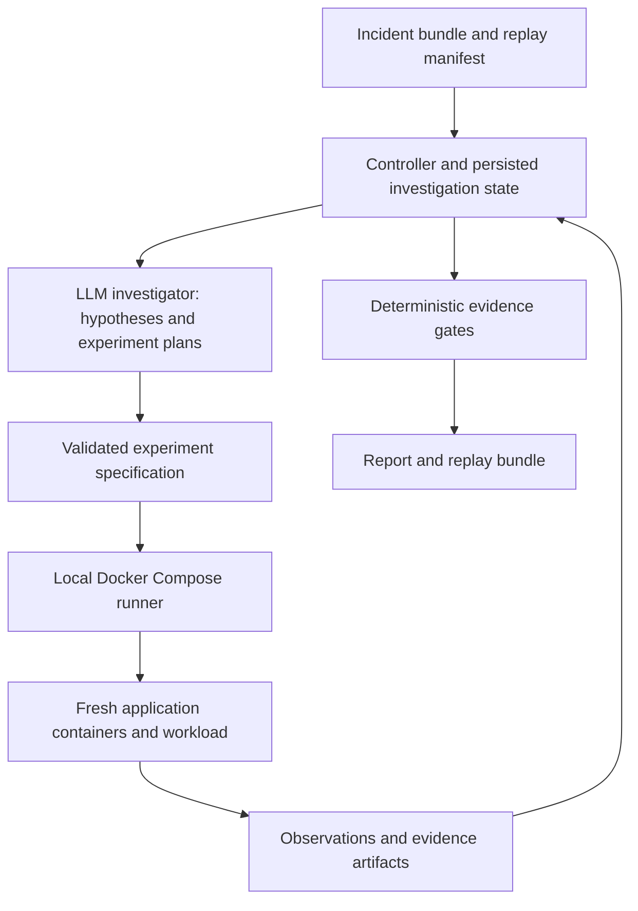

# Sentinel: experimental incident verification

Status: Draft  
Revision: 0.14  
Updated: 2026-11-24  
Approval: Partial. The MVP decisions below are confirmed. The remainder of the original draft contains proposals for discussion.
Existing workspace: Empty Git repository on `main`, with no commits or implementation at inspection.

## Core MVP decisions

These decisions take precedence over the broader roadmap below.

- **Implementation language (confirmed).** Use Python for the local CLI, investigator, deterministic controller, trial runner, and demo API.
- **Investigation storage (confirmed).** The CLI writes one local directory per investigation. Store baseline observations, frozen predictions, trial measurements, and controller verdicts as JSON alongside the Markdown report. The recorded inputs must let the controller re-score the run without a model call. PostgreSQL serves the demo application.
- **Telemetry (confirmed).** Fetch live telemetry directly from the demo application. RestaurantOS integration and a general adapter interface are deferred.
- **Telemetry endpoint (confirmed).** The demo app exposes read-only `GET /telemetry?since=...&until=...`. It returns request events and timestamped pool measurements for the requested window from an in-memory event buffer. At investigation start the controller saves the response in the run directory and assigns stable observation IDs for evidence citations. Acceptance check: with every database connection checked out, the endpoint still returns previously recorded events and measurements for the window without acquiring a database connection.
- **Investigator (confirmed).** The agent inspects evidence, proposes competing mechanisms, and composes experiments from allowed operations. It records predictions before execution. Scenario code defines the permitted measurements, comparisons, and trial-validity rules. The controller alone scores observations and records verdicts.
- **Baseline gate (confirmed).** The controller must establish a successful baseline before accepting any intervention. A successful incident baseline means the workload completed as specified and the declared symptom was observed. Application readiness alone is insufficient.
- **Baseline protocol (confirmed, R2).** Once per investigation, run the same author-defined workload on a clean healthy configuration and a clean incident configuration. Both must reach the final checkpoint with valid measurements. The symptom must be absent on the healthy control and present on the incident configuration. If either check fails, record why and end the investigation with zero interventions. After the gate passes, start each experiment from clean state.
- **First incident (confirmed).** The connection-pool incident is the only incident required for MVP acceptance. Additional incidents belong after the MVP.
- **Source access (confirmed, R3).** From the start of an investigation, the agent can read and cite source files from the incident app revision. The source tool is read-only and scoped to that snapshot. Healthy-control diffs, fixture labels, and evaluator files stay outside its scope. Source evidence can motivate a prediction; the controller still scores it from trial observations.
- **Workload and symptom (confirmed, R2).** Send an ordinary request, issue a batch of requests that trigger exceptions, wait for their handlers to finish, then send a final ordinary request. Score the symptom from the final request's recorded database connection acquisition timeout. A generic HTTP failure is insufficient evidence.
- **Telemetry and interventions (confirmed, R3–R4).** Expose request outcomes, query durations, active request counts, and checked-out connection counts at workload checkpoints. Each experiment varies either pool size or the number of exception-triggering requests. Capture the post-batch checkpoint before issuing the final request so its own connection use cannot affect the measurement. A larger pool allowing the final request to succeed leaves competing explanations unresolved on that evidence alone.
- **Prediction contract (confirmed, R3–R5).** The investigator submits one allowed intervention, evidence references for each hypothesis, and a prediction for each hypothesis using controller-defined measurements, checkpoints, and comparisons. The controller validates and freezes the proposal before execution. The saved proposal and observations are the inputs to scoring.
- **Scoring (confirmed, R5).** Check trial validity first. A missing required measurement makes the trial invalid and leaves the hypotheses unscored for that trial. For a valid trial, the controller records which predictions matched and which conflicted with the observations. A shared match leaves the distinction unresolved. The agent can explain the evidence in the report. Only the controller writes the verdict.
- **Scope (confirmed).** Job idempotency and performance optimization are deferred. The immediate deliverable is the telemetry-to-experiment loop for an internship portfolio.
- **Stopping rule (confirmed, R4–R5).** After both baseline runs pass their checks, allow at most three intervention trials. Each started intervention consumes a slot even if its measurements are invalid. Stop early when a valid trial matches one candidate's frozen prediction and contradicts those of all remaining alternatives. Report that candidate as supported under the tested conditions. At the cap, preserve any unresolved explanations and record budget exhaustion.
- **Rejected plans (confirmed, R4–R5).** If a proposal fails validation, return the specific error and allowed values where applicable. Allow one correction for that plan. Freeze a valid correction before starting its trial. If the correction also fails validation, stop the investigation as unresolved and include both submissions and their errors in the report. Rejected submissions consume zero intervention slots.
- **Interface (confirmed).** One local CLI command runs an investigation and writes a Markdown report alongside its machine-readable evidence. The hosted API and dashboard are post-MVP work.
- **Trial runner (confirmed, R2–R4).** The local runner controls Docker Compose for the trusted demo API and PostgreSQL. For each baseline and intervention trial it starts a fresh app process and connection pool with a clean database fixture. Trials run separately from the observed demo instance. The investigator submits typed proposals through the controller.
- **Model (confirmed).** Use Groq's hosted free tier with `openai/gpt-oss-120b` as the sole provider/model for the first prototype. The MVP model budget is $0. Return relevant source excerpts and checkpoint measurements in tool responses and keep full logs on disk. [Groq tool use](https://console.groq.com/docs/tool-use/overview) and [rate limits](https://console.groq.com/docs/rate-limits).
- **Model feasibility check (approved, pending execution).** After the baseline works, give three fresh model sessions the same recorded incident evidence and tool definitions. For each session, record whether the proposal cites actual observations, specifies an allowed intervention, and commits to predictions that distinguish the competing hypotheses. Review the three outcomes before building the full agent loop.

## Goal and audience

Sentinel investigates application reliability incidents by reconstructing a bounded environment, comparing explicit hypotheses through controlled experiments, and producing replayable evidence for a diagnosis and a candidate fix.

The intended portfolio audience is AI engineering, with substantial backend and general software engineering depth. The user confirmed a solo build over 8–12 weeks. Weekly availability and local Docker resources remain open.

The central research question is:

> Under a fixed investigation budget, does explicit hypothesis comparison and controlled intervention reduce incorrect root-cause claims compared with an agent that only inspects evidence?

A second comparison should test whether the structured protocol improves on a general tool-using agent with the same experiment capabilities. This separates the benefit of executing tests from the benefit of Sentinel's investigation design.

The product is initially an investigation tool for a developer or on-call engineer who can supply application source and a replay manifest. Here, “incident” means application reliability failures, not cybersecurity incident response.

## Contribution and related work

AI incident investigation and automated remediation already have substantial prior work. [ITBench](https://github.com/itbench-hub/ITBench) provides reproducible IT scenarios and agent evaluation, including Kubernetes-based SRE environments. [SREGym](https://github.com/SREGym/SREGym) evaluates agents on operational failures and includes a smaller introductory suite. [STRATUS](https://tianyin.github.io/pub/stratus.pdf) studies autonomous reliability engineering, including transactional mitigation and undo under explicit assumptions.

These sources establish relevant overlap; this preliminary review does not establish research novelty. Sentinel should distinguish its portfolio contribution through a concrete implementation and evaluation of:

- Predictions recorded before experiments, including what would contradict each hypothesis.
- Experiments selected to distinguish alternatives, rather than merely reproduce a symptom.
- Controlled state resets and explicit limits on environment fidelity.
- Evidence that separates reproducing a failure, supporting a mechanism, and validating a patch.
- Reusable reproducer bundles and measured false-verification rates.

A plausible diagnosis, a passing patched test, and proof of the original production cause are different claims. Sentinel must preserve those distinctions.

## Proposed scope

Start with one small Python application: an API, PostgreSQL, and a deterministic workload driver. Add a Redis-backed worker only after the first investigation works end to end.

Use three incident families as a proposed scope ceiling:

1. Resource leaks and exhaustion, such as connections not returned after an exception.
2. Retry and idempotency failures, such as duplicate writes after a lost response.
3. Data or configuration interactions, such as stale cache entries or mismatched timeout settings.

Begin with one family. These are candidates, not a promise that all will fit the available time.

Supported applications provide their topology, fixtures, startup checks, workload, and observability interfaces. Sentinel assembles a declared environment; automatic reconstruction of arbitrary production systems is deferred.

Initial exclusions: production changes, arbitrary cloud or Kubernetes topology inference, full production database copies, universal language support, automatic deployment, and a large collection of specialist agents. Candidate patch generation is a later feature; verifying a supplied patch is sufficient to demonstrate the core.

## Requirements and acceptance criteria

All requirements are proposed for review. No acceptance checks have run.

| ID | Requirement | Observable acceptance criteria |
|---|---|---|
| R1 | Reconstruct declared application state | A manifest identifies source revision, image digests, dependencies, fixtures, configuration, and workload. Missing inputs produce a specific setup failure; they are not silently invented. |
| R2 | Establish a valid reproduction | A fixed failure predicate detects the target symptom on the faulty state and passes an appropriate healthy control. An unrelated startup error does not count as reproduction. Repeatability is reported across clean trials. |
| R3 | Compare competing hypotheses | Each candidate records a mechanism, evidence references, predicted outcomes, and a possible refutation. When alternatives remain plausible, the plan includes an experiment whose predicted observations differ between them. |
| R4 | Execute controlled interventions | Every trial records its baseline, intervention, workload, reset, resource limits, and observations. Paired trials differ only in the declared intervention to the extent the environment supports this. |
| R5 | Make bounded evidence claims | Reports distinguish supported, contradicted, unresolved, and not-testable hypotheses. Missing reproduction, ambiguous alternatives, or invalid controls cannot produce a verified-cause verdict. |
| R6 | Verify a candidate fix independently | The frozen reproducer fails on the original revision and passes on the patched revision. Existing regression checks and held-out workload checks run unchanged. Results describe the tested coverage, not universal absence of regressions. |
| R7 | Isolate execution and enforce budgets | Trials cannot obtain production credentials, unrestricted Docker control, or writable controller files. Limits and cancellation are enforced by the runner. Cleanup and denied-access behavior are tested. |
| R8 | Export replayable evidence | A fresh supported worker can execute the saved reproducer without another model call. The export includes hashes, commands, test definitions, raw observations, and known fidelity gaps. |
| R9 | Recover backend jobs reliably | Restarting the controller preserves investigation state and trial provenance. Retried requests do not create duplicate active trials, abandoned workers are detected, and cleanup is scoped to owned resources. |
| R10 | Evaluate the actual contribution | A versioned benchmark compares observation-only, general experiment-capable, and structured Sentinel runs using controlled model settings and explicit budgets. Incorrect verification, abstention, cost, and unresolved cases are reported. |

## User journey and report

1. The engineer supplies an incident bundle: alert, bounded logs and traces, relevant source revision, configuration, and a replay manifest.
2. Sentinel validates inputs and reports missing prerequisites or unsupported dependencies.
3. A worker reconstructs the relevant services. The runner checks environment readiness separately from the incident predicate.
4. The investigator proposes a small set of hypotheses and an initial experiment.
5. The runner validates the experiment, creates fresh state, executes it, and stores observations.
6. The investigator updates the hypothesis ledger and proposes the next useful experiment until a conclusion or budget limit is reached.
7. If a candidate fix is supplied or later generated, the runner performs unchanged reproduction and regression checks against both revisions.
8. The engineer receives a report and a replay command.

The MVP interface is a local CLI with a generated Markdown report. The report covers early stops as well as completed experiments so a failed baseline leaves an inspectable result.

The report should show the incident symptom, tested environment, hypothesis table, experiment timeline, supporting and contradicting evidence, patch comparison, and unresolved limitations. Every substantive conclusion links to recorded observations.

Report state has separate dimensions:

- Execution: completed, cancelled, budget exhausted, or environment error.
- Reproduction: reproduced, not reproduced, or unstable.
- Hypothesis: supported, contradicted, unresolved, or not testable.
- Patch: not evaluated, passes declared checks, fails checks, or inconclusive.

This prevents an environment failure from looking like a rejected diagnosis, or a verified patch from implying a uniquely established cause.

## First demonstration: connection leak

This is a proposed scenario, not an observed result.

The API begins timing out after requests encounter an exception. Plausible explanations include slow SQL, insufficient pool capacity, and connections not returned on an exception path.

| Experiment | Intended diagnostic value |
|---|---|
| Replay ordinary requests, then a controlled number of failing requests, then ordinary requests again | Establish whether resource use persists after the trigger and whether later requests are affected. |
| Measure query duration and checked-out connections at a quiescent checkpoint | Distinguish slow in-flight work from connections that remain checked out after requests finish. |
| Change pool size while keeping the workload and exception path fixed | Test whether capacity changes the onset of failure. An improvement alone is not evidence that pool size was the cause. |
| Change only connection cleanup on the exception path | Test the predicted mechanism under the same request sequence and starting state. |
| Reintroduce the original cleanup defect in the disposable environment | Test whether the failure returns; omit or report ambiguity if the change cannot be isolated. |
| Run a frozen longer workload and ordinary regression checks | Detect a capacity increase that only delays failure and a patch that damages normal behavior. |

The first automated reproducer should check the connection invariant directly, with timeouts as an accompanying symptom. This should reduce reliance on noisy timing thresholds.

The valuable demonstration is that Sentinel can reject an attractive explanation or symptom-hiding patch. The exact mechanism and outcome must be established by the implementation, not scripted into the agent's answer.

## Experimental protocol

An experiment contains:

- A testable question and the hypotheses it distinguishes.
- Baseline revision, environment fingerprint, and fixture state.
- A declared intervention and unchanged conditions.
- Predictions for each hypothesis, written before execution.
- Observable failure and correctness predicates.
- Reset procedure, trial count, timeout, and stopping condition.

Separate the public application replay contract from private benchmark ground truth. The agent may inspect source and observability data. It must not see oracle labels, hidden fix commits, scenario names revealing the defect, or evaluator-only manifests.

Freeze the incident predicate and generated reproducer before evaluating a patch. Store them outside the patch workspace. Existing regression checks remain authoritative, and evaluator-owned held-out checks are not editable by the investigator.

Use fresh data, processes, caches, and fault schedules for comparisons. For noisy scenarios, use matched workload seeds, repeat trials, vary execution order where useful, and record the host and resource constraints. A seed alone does not make concurrent scheduling deterministic.

A candidate is supported only within the tested model of the application. Where feasible, require mechanism-level observations, removal of the proposed cause, and reintroduction of the failure. If several mechanisms remain observationally equivalent, return the unresolved set.

For an initial selector, rank experiments by expected disagreement between hypothesis predictions, feasibility, and cost. This is a heuristic. Do not label arbitrary model confidence scores as calibrated probabilities or claim formal information gain without a defensible probabilistic model.

Stop when the evidence gate is met, no available experiment can distinguish remaining hypotheses, or a budget is exhausted. An explicit inconclusive result is useful.

## Architecture and interfaces

The LLM decides what to inspect and proposes experiments. Ordinary backend code validates scope, creates jobs, enforces limits, collects results, and applies evidence gates. A second LLM is not the authority for declaring that tests passed.

Proposed stack:

| Area | Initial choice | Reason and alternative |
|---|---|---|
| Controller and investigator | Python, typed schemas, explicit state machine | One language for agent logic and execution tooling. Add a graph orchestration library only if it solves a demonstrated workflow problem. |
| Application environment | Local Docker Compose runner | Each trial starts with a fresh app process, pool, and database fixture on the demo machine. |
| Test execution | pytest plus scenario-specific workload scripts | Executable assertions and repeatable workloads become exportable evidence. |
| Controller state | One local directory per investigation with JSON evidence and a Markdown report | Files allow inspection and independent re-scoring of a single CLI run. |
| Artifacts | Per-run files and JSON manifests, addressed by hashes | Straightforward inspection and replay. Object storage can be added if remote workers require it. |
| Observability | Structured logs and a small set of traces and metrics | Use OpenTelemetry instrumentation where it helps correlate requests and resource behavior; avoid building an observability platform. |
| Presentation | CLI and report first; thin API and dashboard later | Prioritize the investigation protocol and provide visible evidence for the portfolio. |

[Docker's Compose model](https://docs.docker.com/compose/intro/compose-application-model/) supports the proposed service declaration. [OpenTelemetry's signal documentation](https://opentelemetry.io/docs/concepts/signals/) describes the relevant telemetry types. These are technology references, not validation of Sentinel's feasibility.

Proposed records:

- `IncidentBundle`: source revision, observed symptom, telemetry references, replay-manifest reference, redaction metadata.
- `ReplayManifest`: topology, dependency/image pins, fixtures, workload, readiness checks, supported interventions, fidelity gaps.
- `Hypothesis`: mechanism, evidence references, predictions, contradictory observations, current status.
- `ExperimentSpec`: question, hypothesis IDs, baseline, intervention, predicates, reset protocol, budgets.
- `TrialResult`: environment hash, workload seed, measurements, exit status, timestamps, resource usage, artifact references.
- `VerificationReport`: reproduction status, hypothesis assessment, patch result, evidence links, limitations.

Experiment tools should expose bounded operations such as inspect source, retrieve telemetry, reset fixtures, apply an allowed configuration change, run a workload, and test a patch. Add constrained code execution only after the runner boundary works. Log and repository contents are untrusted input; they cannot grant tool permissions or change verification policy.

## Isolation and recovery

Docker is useful for reproducibility and process isolation, but a container alone is not a sufficient boundary for arbitrary untrusted code. Docker's documentation identifies daemon access, mounts, capabilities, and kernel configuration as consequential security concerns. [Docker Engine security](https://docs.docker.com/engine/security/)

The MVP runner controls local Docker for the trusted demo. The investigator and application containers receive neither the Docker socket nor production credentials. The runner accepts validated specifications. Model credentials stay in the controller.

Stage dependency retrieval separately from trial execution. Trial networks permit required application dependencies but deny production and unnecessary external destinations. Containers run with reduced privileges and bounded CPU, memory, processes, output, and elapsed time.

Each trial has an ownership label and lease. Cancellation and worker restart must preserve available evidence and clean up only owned resources. After uncertain worker completion, reconcile job and resource state before retrying. Discard and recreate experimental state when a reset cannot be verified.

Environment fidelity is explicit: pin what can be pinned and list what cannot be reproduced, including missing production data, provider behavior, hardware, traffic distributions, and concurrency timing. Failure to reproduce under incomplete conditions cannot refute a production hypothesis.

## Evaluation

Build three development incidents first, then aim for approximately 12 cases across the chosen families. Reserve cases and workload variants before tuning the agent. Multiple seeds of one case improve repeatability estimates but do not count as independent incident families.

Compare:

1. An observation-only investigator with the same initial evidence and source access.
2. A general tool-using investigator with the same experiment tools as Sentinel.
3. Sentinel's explicit prediction, intervention, and evidence-gating protocol.

Use the same model version, comparable input access, recorded sampling settings, and explicit token, time, and experiment budgets. Report actual spending as well as ceilings. If structured verification helps only by spending more, report that tradeoff.

| Metric | Definition |
|---|---|
| Supported-cause accuracy | Correct supported conclusions divided by all eligible incidents; separately report accuracy among supported conclusions. |
| False-verification rate | Incorrect supported conclusions divided by all supported conclusions; show raw counts and “not applicable” if none are supported. |
| Coverage and abstention | Fraction reaching a supported conclusion versus unresolved/not-testable outcomes. |
| Reproduction reliability | Successful target reproductions across clean repeated runs. |
| Patch acceptance error | Incorrect or regression-inducing patches accepted by the verification protocol. |
| Replay success | Exported bundles that reproduce their recorded result on a fresh supported worker without an LLM call. |
| Efficiency | Wall time to a supported conclusion, model usage/cost, experiment count, and worker time. |

Evaluate diagnosis and patch correctness using withheld scenario ground truth and executable checks, not just a model judging another model's prose. Include misleading telemetry, a healthy case, missing reproduction inputs, a patch that masks the symptom, and at least one inconclusive case.

Report per-case outcomes, repeated-run variation, and uncertainty. A small benchmark can demonstrate engineering value; it cannot support broad claims about all production incidents. A later integration with a subset of ITBench or SREGym could test external validity if resources allow.

## Delivery plan

The schedule assumes 8–12 calendar weeks; feasibility depends on weekly availability and the first prototype.

| Stage | Approximate window | Deliverable and exit condition |
|---|---|---|
| Feasibility spike | First 2–3 working days | Manually demonstrate the connection-leak experiment, clean reset, faulty/healthy separation, and replay bundle. No agent needed. |
| Reproduction foundation | Weeks 1–2 | One incident executes through declared fixtures, workload, isolated runner, evidence capture, and cleanup. |
| Agent experiment loop | Weeks 3–4 | Structured hypotheses, predictions, bounded experiment tools, evidence references, and an inconclusive path. |
| Verification and backend reliability | Weeks 5–6 | Frozen reproducer, supplied-patch evaluation, job persistence, cancellation, leases, and restart recovery. |
| Evaluation and extension | Weeks 7–8 | Development and held-out cases, baseline comparisons, cost tracking, and failure analysis. |
| Portfolio finish | Weeks 9–10 | CLI walkthrough, example report, architecture explanation, replay instructions, recorded demo, and measured results. |
| Buffer or one extension | Weeks 11–12 | Resolve reliability gaps or add one extension such as patch generation, another app, or a benchmark adapter. |

For an eight-week version, retain the CLI/report and verification/evaluation work; defer the dashboard and patch generation.

The feasibility spike should attempt ten fresh trials of a deliberately deterministic case, with the known faulty state failing and the repaired control passing. Record setup time and resource use. If outcomes overlap or resetting state is unreliable, improve the test predicate or narrow the scenario before building agent orchestration. This is a proposed engineering gate, not a statistical guarantee.

## Portfolio evidence

The finished project should make four things easy to inspect:

- AI engineering: structured tool use, experiment selection, grounding, evaluation, and honest abstention.
- Backend engineering: durable state transitions, idempotent jobs, worker leases, cancellation, bounded execution, and artifact provenance.
- Software engineering: usable interfaces, typed contracts, integration tests at critical boundaries, CI, reproducible setup, and documented tradeoffs.
- Technical judgment: a rejected hypothesis, a rejected bad patch, and an unresolved incident shown alongside successful cases.

Publish the actual measured benchmark results and limitations. A future CV bullet can describe a controlled incident-verification agent and its measured improvements, but should not invent accuracy, reliability, or production impact before evaluation.

## Open decisions

Confirmed by the user: AI engineering as the primary audience, strong backend/software engineering depth, solo 8–12 week scope.

Still open:

- Weekly hours and available local Docker CPU/RAM.
- Numeric fixture settings for pool size, exception batch size, and acquisition timeout. Calibrate these in the feasibility spike.

These affect implementation planning; they do not prevent discussion of the proposed direction.

## Decision history

| Date | Decision or proposal | Evidence and status |
|---|---|---|
| 2026-11-24 | Live demo telemetry, bounded agent-composed experiments, independent controller verdicts, and a mandatory baseline gate | Confirmed by the user. Exact baseline protocol pending review. |
| 2026-11-24 | Gate interventions on a healthy-control run and incident reproduction once per investigation. Require only the connection-pool incident for the MVP. | User accepted both choices in revision 0.3. |
| 2026-11-24 | Use the final request's acquisition timeout as the symptom, capture checkpoint telemetry, and vary one of two supported factors per experiment. | User accepted the workload and toolset recommendations, recorded in revision 0.4. |
| 2026-11-24 | Freeze typed predictions before execution and score them against recorded observations in controller code. | User accepted the prediction contract, recorded in revision 0.5. |
| 2026-11-24 | Allow read-only access to incident app source from the start of an investigation. | User accepted the source-access recommendation, recorded in revision 0.6. |
| 2026-11-24 | Ship the CLI and report as the MVP interface. Defer the hosted API and dashboard. | User confirmed the interface scope, recorded in revision 0.7. |
| 2026-11-24 | Allow three intervention trials in addition to the baseline pair, with early stopping on a discriminating result. | User approved the stopping rule, recorded in revision 0.8. |
| 2026-11-24 | Run trusted demo trials in fresh local Docker Compose environments. | User approved the local Compose runner, recorded in revision 0.9. |
| 2026-11-24 | Use Groq-hosted `openai/gpt-oss-120b` on a $0 model budget and assess its proposals in three fresh sessions after baseline reproduction. | User approved the model recommendation and feasibility check, recorded in revision 0.10. |
| 2026-11-24 | Use Python throughout the MVP application and investigation tooling. | User confirmed Python, recorded in revision 0.11. |
| 2026-11-24 | Store each investigation in a local directory with JSON evidence and a Markdown report. | User confirmed the storage recommendation, recorded in revision 0.12. |
| 2026-11-24 | Fetch windowed telemetry from a read-only endpoint backed by the demo app's in-memory buffer, and preserve the observations for citation. | User approved the endpoint and pool-exhaustion check, recorded in revision 0.13. |
| 2026-11-24 | Allow one correction per invalid experiment plan and stop as unresolved on a second rejection. | User confirmed the correction rule, recorded in revision 0.14. |
| 2026-10-20 | Focus on experimental root-cause verification, isolated reconstruction, and evidence-based fix validation | User's original project goals; accepted goals. |
| 2026-10-20 | Optimize for AI engineering with backend/software engineering depth; solo 8–12 weeks | User's clarification; accepted constraints. |
| 2026-10-20 | Use declared replay environments, one investigator, connection-leak first demo, and comparative evaluation | Revision 0.1 recommendations; pending review. |

No code, experiments, or benchmarks were implemented or executed during this design discussion.
